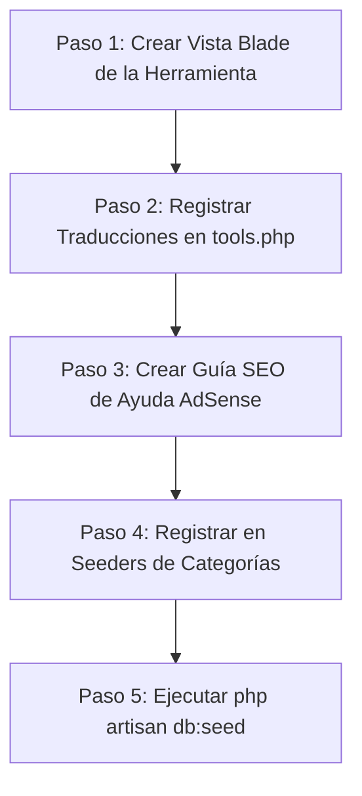

# Guía Definitiva de Arquitectura y Creación de Herramientas para Agentes IA (MicroUtils)

Esta guía sirve como un prompt técnico de alta prioridad y flujo de trabajo estructurado para Agentes IA (o desarrolladores) que necesiten crear, integrar y registrar nuevas herramientas (calculadoras, generadores, formateadores, etc.) en la plataforma **MicroUtils** (Laravel + Vite + Vanilla JS). 

Sigue este flujo de trabajo de forma exacta para mantener el SEO bilingüe, los sitemaps dinámicos, la privacidad del usuario y la compatibilidad con Google AdSense.

---

## 1. Visión General de la Arquitectura

MicroUtils utiliza una arquitectura modular donde el "caparazón" (Navbar, Hero Banner, Footer, Anuncios AdSense, SEO general) es gestionado automáticamente por la base de datos y un controlador central (`ToolController`). Las herramientas individuales son "Componentes Blade" que se inyectan dinámicamente en este caparazón.

### Reglas Críticas (Lo que NO debes hacer):
*   **NO** crees nuevas rutas en `routes/web.php` para la herramienta (las rutas dinámicas `/tool/{slug}` ya existen y son manejadas por `ToolController@show`).
*   **NO** crees nuevos controladores para herramientas individuales. Toda la base visual se renderiza desde `resources/views/tools/base.blade.php`.
*   **NO** modifiques middlewares de idioma (`Localization.php`) ni controladores del mapa de sitio (`SitemapController.php`). El mapa de sitio lee directamente los registros activos de la base de datos.
*   **NO** inyectes esquemas de datos estructurados (JSON-LD) manuales en la vista. `tools/base.blade.php` genera de forma automatizada y dinámica esquemas válidos de `BreadcrumbList` y `SoftwareApplication` para SEO estructurado.

---

## 2. Paso a Paso para la Creación de una Herramienta



### Paso 2.1: Crear la Vista Interactiva (UI y Lógica Frontend)
Crea un nuevo archivo Blade en `resources/views/tools/implementations/{slug}.blade.php`.

*   **Alcance**: Este archivo solo debe contener el cuerpo de la herramienta (el contenedor HTML y un tag `<script>` al final). **No** incluyas etiquetas `<html>`, `<head>`, `@extends` ni `@section`.
*   **Privacidad (Client-Side First)**: Los cálculos e interacciones **deben ejecutarse 100% localmente en el navegador usando Vanilla JS**. Evita llamadas de backend innecesarias.
*   **Estilo Visual**: Usa clases nativas de Bootstrap 5. Diseña tarjetas limpias con `border-0 shadow-sm bg-light` o `border border-light shadow-none`, alineadas con la estética premium de MicroUtils. Emplea la librería Remix Icons para iconografía (ej. `<i class="ri-settings-line"></i>`).

#### Estructura Estándar de la Vista:
```html
<div class="mi-herramienta-wrapper">
    <div class="row g-3">
        <!-- Panel de Entrada -->
        <div class="col-12 col-md-6">
            <div class="card border-0 shadow-sm bg-light h-100">
                <div class="card-body p-4">
                    <label for="input-data" class="form-label fw-bold">@lang('tools.mi_campo_entrada')</label>
                    <textarea class="form-control shadow-none" id="input-data" rows="6"></textarea>
                    
                    <button type="button" class="btn btn-primary w-100 mt-3" id="btn-procesar">
                        <i class="ri-play-line align-middle me-1"></i> @lang('tools.mi_boton_accion')
                    </button>
                </div>
            </div>
        </div>

        <!-- Panel de Salida / Resultados -->
        <div class="col-12 col-md-6">
            <div class="card border-0 shadow-sm h-100">
                <div class="card-body p-4 text-center d-flex flex-column justify-content-center align-items-center">
                    <h6 class="fw-bold mb-2">@lang('tools.mi_campo_salida')</h6>
                    <div class="w-100 bg-dark text-white rounded p-3 text-monospace" id="output-result" style="font-family: monospace; min-height: 120px;">
                        <!-- Los resultados aparecerán aquí -->
                    </div>
                </div>
            </div>
        </div>
    </div>
</div>

<script>
document.addEventListener("DOMContentLoaded", function() {
    // Encapsular lógica para prevenir colisiones globales de variables
    const elInput = document.getElementById('input-data');
    const elOutput = document.getElementById('output-result');
    const btnProcesar = document.getElementById('btn-procesar');

    btnProcesar.addEventListener('click', function(e) {
        e.preventDefault();
        const value = elInput.value.trim();
        
        if(!value) {
            elOutput.textContent = "@lang('tools.mi_mensaje_error')";
            return;
        }

        // Lógica 100% en el dispositivo del cliente
        elOutput.textContent = value.toUpperCase();
    });
});
</script>
```

---

### Paso 2.2: Registrar Traducciones (i18n)
MicroUtils es una plataforma bilingüe. **NO** agregues traducciones de herramientas dentro del archivo general `translation.php`. Debes registrarlas dentro de los archivos específicos de traducción de herramientas:

*   **Español**: `resources/lang/es/tools.php`
*   **Inglés**: `resources/lang/en/tools.php`

Abre ambos archivos y añade al final (dentro del array asociativo devuelto) las claves de tu herramienta:

```php
// En resources/lang/es/tools.php
return [
    // ... traducciones existentes ...
    
    // Mi Nueva Herramienta
    'mi_campo_entrada' => 'Datos de Entrada',
    'mi_boton_accion' => 'Procesar Datos',
    'mi_campo_salida' => 'Resultado del Procesamiento',
    'mi_mensaje_error' => 'Por favor, ingresa información válida.',
];
```

En las plantillas Blade, invoca estas traducciones exclusivamente con el prefijo `tools`:
```html
@lang('tools.mi_campo_entrada')  // Correcto
@lang('translation.mi_campo_entrada')  // INCORRECTO (Causará fallos de traducción)
```

---

### Paso 2.3: Crear la Guía SEO de Ayuda (Imprescindible para AdSense)
Para evitar penalizaciones y rechazos por parte de Google AdSense debido a **"Contenido de Bajo Valor" o "Thin Content"**, cada herramienta debe incluir una guía exhaustiva de ayuda y documentación de uso de al menos **300 - 500 palabras**.

*   **Ruta del Archivo**: `resources/views/tools/guides/{slug}.blade.php` (el nombre del archivo debe coincidir exactamente con el `slug` que registrarás en la base de datos).
*   **Contenido Localizado**: Utiliza directivas condicionales de Blade (`@if(app()->getLocale() == 'es') ... @else ... @endif`) para renderizar el texto correspondiente al idioma activo.
*   **Componente Premium**: Agrega alertas bootstrap que refuercen la privacidad y el procesamiento en cliente (`bg-success-subtle border-0`).

#### Plantilla de la Guía SEO (`guides/{slug}.blade.php`):
```html
<div class="card border-0 shadow-sm mt-5">
    <div class="card-body p-4">
        @if(app()->getLocale() == 'es')
            <h4 class="text-primary mb-3">
                <i class="ri-article-line me-2 align-middle"></i>Guía de Uso: [Nombre de la Herramienta]
            </h4>
            <p class="text-muted">Introduce detalladamente la herramienta. Explica qué problema resuelve en el día a día y a qué público objetivo beneficia.</p>
            
            <h5 class="text-dark mt-4">¿Cómo utilizar esta herramienta en línea?</h5>
            <ol class="text-muted ps-3 mb-4">
                <li>Instrucción paso 1...</li>
                <li>Instrucción paso 2...</li>
                <li>Instrucción paso 3...</li>
            </ol>

            <h5 class="text-dark">Seguridad y Privacidad de Datos</h5>
            <div class="alert alert-success border-0 shadow-none bg-success-subtle mb-0">
                <i class="ri-shield-check-line label-icon align-middle fs-18 me-2 text-success"></i>
                <strong>Procesamiento Local:</strong> Garantizamos la privacidad de tus datos. Todo el procesamiento se realiza en tu navegador web localmente a través de JavaScript de manera inmediata. Ningún dato sensible es transmitido ni almacenado en nuestros servidores.
            </div>
        @else
            <h4 class="text-primary mb-3">
                <i class="ri-article-line me-2 align-middle"></i>User Guide: [Tool Name]
            </h4>
            <p class="text-muted">Introduce the tool thoroughly. Explain what specific problem it solves in daily operations and who benefits from it.</p>
            
            <h5 class="text-dark mt-4">How to use this online tool?</h5>
            <ol class="text-muted ps-3 mb-4">
                <li>Step 1 instruction...</li>
                <li>Step 2 instruction...</li>
                <li>Step 3 instruction...</li>
            </ol>

            <h5 class="text-dark">Data Privacy & Security Guaranteed</h5>
            <div class="alert alert-success border-0 shadow-none bg-success-subtle mb-0">
                <i class="ri-shield-check-line label-icon align-middle fs-18 me-2 text-success"></i>
                <strong>Local Execution:</strong> We care deeply about your privacy. All processing is computed entirely on your device via client-side JavaScript. Your confidential strings never leave your device.
            </div>
        @endif
    </div>
</div>
```

---

### Paso 2.4: Registrar en los Seeders del Sistema
Para que la herramienta sea visible en la navegación pública y aparezca bajo la categoría correspondiente, agrégala en el array de datos del Seeder.

1. Identifica el archivo PHP de la categoría de destino en `database/seeders/data/categories/`:
   * `desarrollo.php` (Para herramientas orientadas a desarrolladores, formateadores, etc.)
   * `texto-y-seo.php` (Para contadores de palabras, utilidades SEO, convertidores de texto, etc.)
   
2. Añade un nuevo elemento al array devuelto respetando la estructura con traducciones de Spatie (`translatable`):

```php
return [
    // ... herramientas existentes ...

    [
        'slug' => 'mi-nueva-herramienta', // Debe ser único, minúsculas, separado por guiones
        'name' => [
            'es' => 'Mi Nueva Herramienta',
            'en' => 'My New Tool'
        ],
        'description' => [
            'es' => '<p>Una potente y veloz micro-herramienta para automatizar tus tareas.</p>',
            'en' => '<p>A powerful and rapid micro-utility to automate your tasks.</p>'
        ],
        'blade_view_name' => 'tools.implementations.mi-nueva-herramienta', // Ruta interna del Paso 1
        'is_active' => true,
        'order' => 5, // Orden relativo dentro de la categoría
        'seo' => [
            'title' => [
                'es' => 'Mi Nueva Herramienta Gratis en Línea | MicroUtils',
                'en' => 'Free Online Tool Utility | MicroUtils'
            ],
            'description' => [
                'es' => 'Utiliza nuestra micro-herramienta gratuita para procesar información al instante. Sin registros, 100% local y seguro.',
                'en' => 'Use our free online micro-utility to process data instantly. Fully secure, client-side, and registration-free.'
            ],
            'keywords' => [
                'es' => 'herramienta gratis, procesador online, utilidad rapida',
                'en' => 'free tool, online formatter, fast utility'
            ]
        ]
    ]
];
```

---

### Paso 2.5: Aplicar Cambios en la Base de Datos
Una vez configurado el Seeder, avisa al usuario para que ejecute el siguiente comando de artisan en su terminal o hazlo tú mismo si dispones de permisos de consola activa:

```bash
php artisan db:seed --class=ToolSeeder
```

Este comando limpia el estado de las herramientas previas en la base de datos y recrea todos los registros leyendo los archivos seeders dinámicamente, refrescando al instante la interfaz principal y los metadatos SEO.

---

## 3. Checklist de Calidad para el Agente IA

Antes de finalizar la adición de cualquier herramienta, verifica el cumplimiento de los siguientes puntos:
*   [ ] ¿El archivo Blade de lógica está en `resources/views/tools/implementations/`?
*   [ ] ¿El archivo Blade de la guía SEO está en `resources/views/tools/guides/` y coincide exactamente con el slug?
*   [ ] ¿Las traducciones de la herramienta están en `resources/lang/{en,es}/tools.php`?
*   [ ] ¿Las llamadas de traducción en el código Blade usan `@lang('tools.key')` o `__('tools.key')`?
*   [ ] ¿Toda la lógica de computación ocurre en cliente (Vanilla JS/CSS) preservando la privacidad del usuario?
*   [ ] ¿Es adaptativo (Responsive) en dispositivos móviles usando las columnas de Bootstrap (`col-12 col-md-6`)?
*   [ ] ¿Las dependencias externas (librerías JS CDN) tienen un hash de `integrity` (SRI) verificado y correcto en los tags `<script>`?
